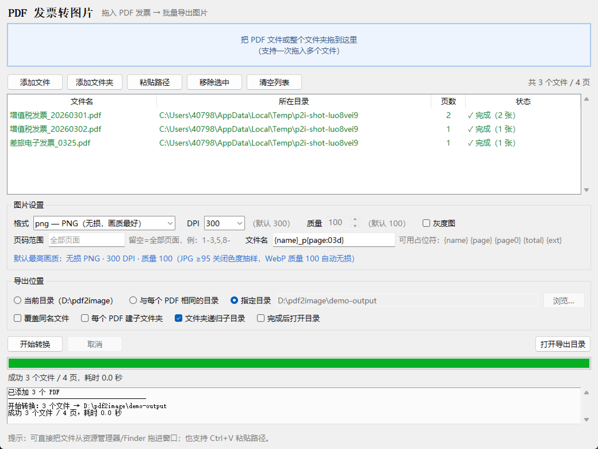

# PDF 发票转图片（pdf2img）

把 PDF 发票批量转成图片的小工具，**Windows 和 macOS 都能用**。

- 🖱 **批量拖入**：把一批 PDF 文件（或整个文件夹）直接拖进窗口，也支持按钮添加 / 剪贴板粘贴路径
- 🖼 **批量导出**：一次转换多个 PDF、多页文件，格式支持 PNG / JPG / TIFF / WebP
- 📁 **导出目录可选**：默认导出到**当前目录**；也可选「与每个 PDF 相同的目录」或任意指定目录
- ⚙️ 常用选项：DPI（清晰度，默认 300）、质量（默认 100）、灰度、页码范围（如 `1-3,5`）、文件名模板
- 🏆 **默认就是最高画质**：无损 PNG + 300 DPI + 质量 100（JPG 关闭色度抽样，WebP 自动无损）
- 🔒 支持加密 PDF（会提示输入密码）
- 🧵 多线程转换、实时进度、可随时取消
- ⌨️ 附带命令行版本，方便批处理和定时任务



---

## 一、直接运行（推荐先用这种方式）

### Windows

1. 装 [Python 3.9+](https://www.python.org/downloads/windows/)（安装时**勾选 “Add python.exe to PATH”**）
2. 双击项目里的 **`run_windows.bat`**
   - 首次运行会自动安装依赖，之后直接双击即可
   - 也可以把 PDF 拖到这个 bat 文件上，或把 PDF 拖到窗口里

### macOS

1. 装 [Python 3.9+](https://www.python.org/downloads/macos/)（官方安装包自带 Tk，最省事）
   - 若用 Homebrew 的 Python，需要额外执行：`brew install python-tk`
2. 首次先执行一次：`chmod +x run_macos.command`
3. 双击 **`run_macos.command`**（若提示“无法打开，因为来自身份不明的开发者”，右键 → 打开）

### 手动方式（两个平台通用）

```bash
pip install -r requirements.txt
python pdf2image_app.py          # 打开图形界面
```

---

## 二、打包成免安装程序（发给别人用，不需要装 Python）

### Windows

双击 **`packaging\build_windows.bat`**，完成后在 `dist\` 得到：

| 产物 | 说明 |
| --- | --- |
| `dist\PDF发票转图片.exe` | 图形界面版，**双击即用**，自带 PyMuPDF / Pillow / 拖拽库 |
| `dist\pdf2img.exe` | 命令行版 |

### macOS：一键生成可直接双击运行的客户端（.app）

> 注意：Windows 上**无法**生成 macOS 的 `.app`（PyInstaller 不支持跨平台编译），
> 必须在 macOS 上构建一次；没有 Mac 的话看下面的「云端构建」。

**方式 A：有 Mac —— 双击一次即可**

1. 装 [Python 3.9+](https://www.python.org/downloads/macos/)（官方安装包自带 Tk，最省事）
   - Homebrew 用户先执行：`brew install python@3.12 python-tk@3.12`
2. 首次先在「终端」里给脚本运行权限（只需一次）：

   ```bash
   cd 到项目目录
   chmod +x "打包Mac客户端.command"
   ```

3. 双击 **`打包Mac客户端.command`**，等待 1–3 分钟，结束后会自动打开 Finder。
   也可以直接在终端里跑（不需要 chmod）：

   ```bash
   bash 打包Mac客户端.command          # 本机架构
   bash 打包Mac客户端.command --universal   # Intel + Apple Silicon 通用版
   ```

4. 得到 `dist/PDF发票转图片.app` —— **双击就能用**，建议拖进「应用程序」。

脚本会自动完成：建独立虚拟环境装依赖（不污染系统 Python，也绕开 Homebrew 的
`externally-managed-environment` 限制）→ 用系统自带 `sips`/`iconutil` 生成 `.icns` 图标
→ 打包 → **ad-hoc 签名**（Apple Silicon 上未签名的 App 会被系统直接杀掉）→ 清除
quarantine 隔离标记。

> 首次打开若仍提示"无法验证开发者"：在 App 图标上**右键 → 打开 → 再点打开**，
> 或执行 `xattr -dr com.apple.quarantine "/Applications/PDF发票转图片.app"`。

**方式 B：没有 Mac —— 用 GitHub Actions 在云端构建**

项目已带好工作流 `.github/workflows/build-desktop.yml`：

1. 把项目推到 GitHub 仓库
2. 打开仓库页 → **Actions** → 左侧选「构建桌面客户端」→ **Run workflow**
3. 构建完在该次运行页面底部 **Artifacts** 下载：

   | 产物 | 适用机器 |
   | --- | --- |
   | `PDF发票转图片-macOS-arm64.zip` | Apple Silicon（M1/M2/M3/M4） |
   | `PDF发票转图片-macOS-x86_64.zip` | Intel Mac |
   | `PDF发票转图片-Windows.zip` | Windows |

4. 解压后把 `.app` 拖进「应用程序」；首次打开若提示未验证，右键 → 打开

云端构建同时会跑一遍核心测试，产物还会自动执行 `--selftest`，通过才上传。

**方式 C：只在这台 Mac 上自己用（无需打包）**

```bash
bash run_macos.command          # 或给权限后双击
```

### macOS 使用小贴士

- **默认导出目录**：双击 `.app` 启动时，macOS 给的工作目录是 `/`（不可写），
  程序会自动改用**桌面**（桌面不存在则用主目录）；界面上会显示实际路径，
  也可以直接选「指定目录」。
- 拖拽需要 `tkinterdnd2`，打包版已内置；源码运行时由 `requirements.txt` 安装。
- 未签名的 App 在 Apple Silicon 上必须做 ad-hoc 签名，构建脚本已处理；
  如果要正式分发（不弹任何提示），需要 Apple 开发者账号做公证（notarization）。

> 打包脚本会先自动安装依赖、生成图标，再调用 PyInstaller，首次约 1–3 分钟。

打包后可自检，确认依赖和渲染都正常：

```bash
dist\pdf2img.exe --selftest           # Windows
./dist/pdf2img --selftest             # macOS
```

---

## 三、界面说明

| 区域 | 说明 |
| --- | --- |
| 拖拽区 | 拖入 PDF 文件或文件夹（支持一次拖多个）。也可以点击它选择文件 |
| 添加文件 / 添加文件夹 | 按钮方式添加；文件夹会递归查找里面的 PDF |
| 粘贴路径 | 从剪贴板读取路径（拖拽不可用时的兜底），快捷键 `Ctrl+V` |
| 移除选中 / 清空列表 | 列表操作，`Delete` 键也能移除选中项 |
| 格式 | **PNG（默认，无损、画质最好）** / JPG（体积小）/ TIFF（无损）/ WebP（质量 100 时为无损） |
| DPI | 清晰度，**默认 300（最高画质）**；数字越大越清晰、文件越大，可调低到 150–200 换体积 |
| 质量 | 仅 JPG / WebP 生效（1–100，**默认 100，最高画质**；100 时 WebP 走无损） |
| 灰度图 | 输出黑白，体积更小 |
| 页码范围 | 留空=全部页面；支持 `1-3,5,8-`（`8-` 表示第 8 页到最后一页） |
| 文件名 | 模板，默认 `{name}_p{page:03d}`，例如 `发票_p001.png` |
| 导出位置 | ① 当前目录（默认）② 与每个 PDF 相同的目录 ③ 指定目录 |
| 覆盖同名文件 | 不勾选时自动改名为 `xxx (2).png`，不会覆盖已有文件 |
| 每个 PDF 建子文件夹 | 每个 PDF 的图片放进它自己的同名文件夹 |
| 完成后打开目录 | 转换结束后自动打开导出目录 |

### 文件名模板占位符

| 占位符 | 含义 | 示例 |
| --- | --- | --- |
| `{name}` / `{stem}` | 原 PDF 文件名（不含扩展名） | `发票` |
| `{page}` | 页码，从 1 开始（可写 `{page:03d}` 补零） | `007` |
| `{page0}` | 页码，从 0 开始 | `6` |
| `{total}` | 该 PDF 的总页数 | `10` |
| `{ext}` | 图片扩展名 | `png` |
| `{dpi}` | 当前 DPI | `200` |

例：模板 `{name}-{page}of{total}` → `发票-1of2.png`、`发票-2of2.png`。

---

## 四、命令行用法

```bash
# 转换一个文件夹里的所有 PDF 到「输出」目录，300 DPI、JPG
python pdf2image_app.py --cli 发票/*.pdf -o 输出 -f jpg -d 300

# 只转第 1-2 页，灰度，每个 PDF 建子文件夹
python pdf2image_app.py --cli 发票.pdf -p 1-2 --gray --subfolder -o 输出

# 打包后的 exe 用法相同
dist\pdf2img.exe D:\发票 -o D:\出图 -f png -d 200
```

常用参数（`--help` 可看全部）：

| 参数 | 说明 |
| --- | --- |
| `inputs` | PDF 文件 / 目录 / 通配符，可多个 |
| `-o, --out` | 导出目录，**不填则用当前目录** |
| `-f, --format` | `png`（默认）/ `jpg` / `tiff` / `webp` |
| `-d, --dpi` | 分辨率，默认 300（最高画质） |
| `-q, --quality` | JPG/WebP 质量，默认 100（100 时 WebP 无损） |
| `-p, --pages` | 页码范围，如 `1-3,5,8-` |
| `-t, --template` | 文件名模板 |
| `--gray` / `--overwrite` / `--subfolder` | 灰度 / 覆盖同名 / 每 PDF 建子目录 |
| `--password` | 加密 PDF 的密码 |
| `--no-recursive` | 输入目录时不递归子目录 |
| `--selftest` | 自检并输出报告 |

---

## 五、常见问题

**Q：拖拽没反应？**
确认已安装 `tkinterdnd2`（`pip install tkinterdnd2`）。窗口底部会提示拖拽是否可用；不可用时可以用「添加文件」「粘贴路径」或 `Ctrl+V`。

**Q：macOS 报 `No module named '_tkinter'`？**
用的是没带 Tk 的 Python。Homebrew 用户执行 `brew install python-tk`，或改用 python.org 官方安装包。

**Q：Linux 能用吗？**
核心和命令行可以在 Linux 跑（`pip install -r requirements.txt`）；图形界面依赖系统装了 Tk，PyInstaller 打包脚本目前只针对 Windows / macOS。

**Q：默认画质是怎样的？**
默认就是**最高画质**：无损 PNG + 300 DPI + 质量 100（WebP 在 100 时自动改无损编码，JPG 在 ≥95 时关闭色度抽样）。A4 发票导出一页约 2480×3508 像素，足够打印和放大核对。若更在意体积，把 DPI 调到 150–200、或改用 JPG 并把质量设到 80 左右即可。

**Q：转换很慢？**
会按 CPU 自动开多线程。页数多时降低 DPI 提升最明显；也可以用 `--workers`（命令行）手动指定线程数。

**Q：加密 PDF 怎么办？**
界面在添加文件时会提示输入密码；命令行用 `--password 密码`。

**Q：导出目录没设置会存到哪？**
**当前工作目录**（界面上会显示具体路径）。从资源管理器双击 exe 时通常是 exe 所在目录；用 bat/python 启动时是命令行所在目录。
例外：macOS 双击 `.app` 时系统给的工作目录是 `/`（不可写），Windows 装在 `Program Files` 下同理，
这时会自动改用**桌面**（没有桌面则用主目录），界面上会显示实际路径。

---

## 六、目录结构

```
pdf2image_app.py            统一入口：无参数=图形界面，有参数=命令行
invoice2img/
  core.py                   转换引擎（无 GUI 依赖，可单独调用/测试）
  gui.py                    Tkinter 图形界面（含拖拽）
  cli.py                    命令行界面 + --selftest
assets/                     图标、界面截图
packaging/
  pdf2image.spec            PyInstaller 配置（Windows/macOS 共用）
  build_windows.bat         Windows 打包
  build_macos.sh            macOS 一键构建（虚拟环境 + icns + 签名）
打包Mac客户端.command         macOS 双击即可构建客户端
run_windows.bat             Windows 一键运行
run_macos.command           macOS 一键运行
.github/workflows/          云端构建 macOS/Windows 客户端（无需 Mac）
tools/                      生成图标、生成界面截图的辅助脚本
tests/                      自动化测试（核心 + 命令行 + 图形界面 + 打包脚本体检）
```

## 七、开发者：跑测试

```bash
python -m unittest discover -s tests -v     # 68 个用例，含 GUI 端到端
```

测试包含：页码解析、文件名清理、DPI/格式/灰度、页码范围、同名改名、子目录、
默认导出到当前目录（含不可写时的回退）、加密 PDF、取消、超大页保护、命令行参数、
**图形界面拖入 → 转换 → 导出**的完整流程，以及**打包脚本体检**（`.command`/`.sh`
必须是 LF 换行、`.bat` 必须是 CRLF、shell 语法用 `bash -n` 实检、spec 可编译、
图标尺寸齐全、CI 工作流 YAML 合法且两个平台矩阵正确）。
